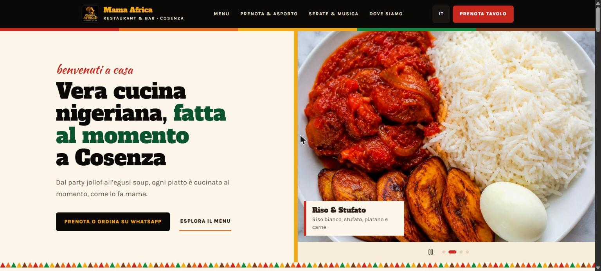
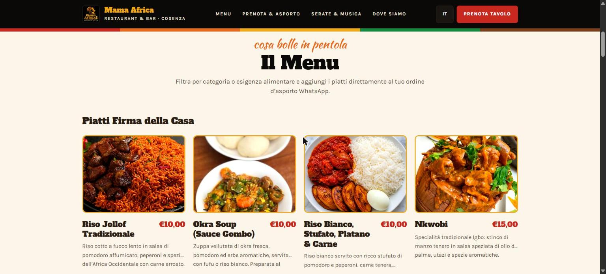
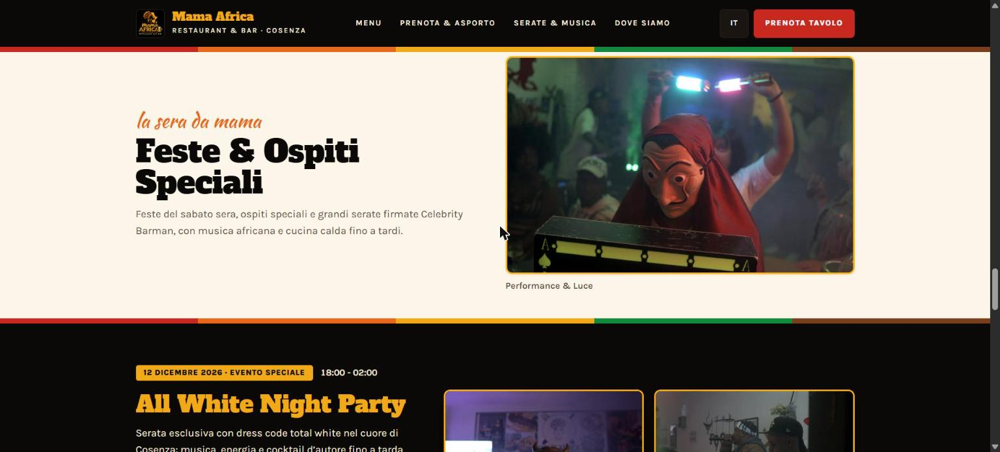

# Mama Africa Restaurant & Bar

Website for Mama Africa Restaurant & Bar, a Nigerian restaurant and bar at Via Pietro Pompilio Rodotà 12/14, Cosenza. Guests can browse the menu, build a takeaway order, book a table or a special night, and see past and upcoming events. Every booking and order is sent to the restaurant as a ready-made WhatsApp message; there is no backend.

Live site: https://makmotrobin.github.io/mama-africa/



## Features

- **Menu** of the restaurant's Nigerian dishes with category filters, signature dishes and add-to-order buttons.
- **Takeaway order** with quantities and an estimated total, sent as a WhatsApp message.
- **Table booking** with validation: no past dates, no closed days, times inside opening hours. Bookings during a special event (for example the All White Night) are accepted for the whole event, even outside regular hours.
- **Events**: the next special night and a list of past nights, taken from the owner's Instagram (@celebritybarmann).
- **Italian and English**, switchable from the header; Italian is the default.
- **Location** with address, opening hours, WhatsApp and phone links, and a Google map that loads only after the visitor asks for it (no Google requests before that).





## Design

The "Ankara Table" design is built from the restaurant's logo: cream pages, black and gold structure, the headwrap stripes and the zigzag triangle row as borders, Alfa Slab One for headings, Kaushan Script for short kickers and Karla for text. Solid colours only. Design tokens live in `src/styles/tokens.css`, shared buttons in `src/styles/buttons.css`, and the logo motifs in `src/components/brand/`.

## Where to change content

| What | File |
|---|---|
| Dishes, prices, photos | `src/data/menu.ts` (`MENU_ITEMS`) |
| Upcoming and past events | `src/data/menu.ts` (`CULTURAL_EVENTS`, `PAST_EVENTS`) |
| Opening hours (display and booking rules) | `src/config/restaurant.ts` (`OPENING_SCHEDULE`) |
| Phone, WhatsApp, address, Facebook | `src/config/restaurant.ts` (`RESTAURANT_CONFIG`) |
| All page text, Italian and English | `src/i18n/translations.ts` |
| Search and sharing tags, Restaurant schema | `index.html` |

Opening hours, confirmed by the owner: Monday to Friday 09:00-23:00, Saturday 09:00-01:00, Sunday 11:00-23:00. If they change, update `OPENING_SCHEDULE` and the `openingHoursSpecification` in `index.html` together; a test checks that the schema matches.

## Development

Requires Node.js 22.

```bash
npm install
npm run dev      # local site at http://localhost:5173
npm test         # Vitest test suite
npm run lint     # Oxlint
npm run build    # type-check and production build into dist/
```

Stack: React 19, TypeScript, Vite, Tailwind CSS v4, lucide-react, Vitest with Testing Library.

## Deployment

Every push to `main` builds the site and deploys it to GitHub Pages through `.github/workflows/deploy.yml`. Work happens on a branch per change and is merged into `main` when it is ready.
